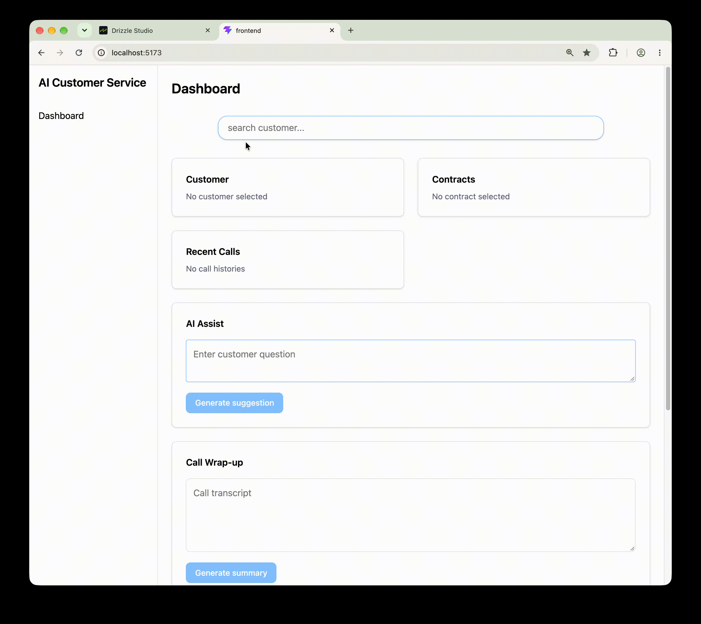

# AI Call Center
An AI assistant platform designed to reduce the time agents spend searching for information and help them provide fast, accurate, policy-based answers using local LLMs and RAG.

## Demo



## AI Workflow

```text
Customer Search
        ↓
Customer / Contract Context
        ↓
Customer Question
        ↓
Selected Contract
        ↓
Policy Type Filter (e.g, HEALTH,AUTO)
        ↓
Vector Search & Top 3 Relevant Policy Chunks
        ↓
local LLM
        ↓
Suggested Answer + Sources
        ↓
Call Transcript
        ↓
Customer Request Summary
        ↓
Agent Review
```

## Implementation Details

### Structured LLM Output with Zod

The LLM is used to classify customer questions and determine whether policy search is required.

Instead of trusting raw LLM JSON, I defined the expected output with Zod.

```ts
const AnalyzeResultSchema = z.object({
  intent: CustomerIntentSchema,
  needsPolicySearch: z.boolean(),
})
```

The same Zod schema is converted to JSON Schema and passed to Ollama as the structured output format.

The response returned by Ollama is validated again with Zod before it is used by the application.

This prevents malformed or unexpected LLM output from directly entering the application flow.

### Policy RAG with pgvector

Policy documents are stored in PostgreSQL and split into smaller chunks.

Each chunk is embedded with `nomic-embed-text` and stored in `policy_chunks` using pgvector.

The LLM is instructed to answer only from the retrieved policy context.

This reduces reliance on the model's general knowledge and produces a more grounded response.

### Why PostgreSQL + pgvector

The application already uses PostgreSQL for customers, contracts, policies, and call histories.

Using pgvector keeps relational data and embeddings in the same database 
and allows `relational filtering` to be combined with `vector similarity search`.

```text
Selected Contract
→ Contract Type
→ Filter Matching Policies
→ Vector Similarity Search
→ Top Policy Chunks
```

### Contract-Aware Retrieval

A customer can have multiple contracts, so the agent selects the contract related to the current conversation.

The selected `contractNumber` is sent together with the customer question.

The backend loads the contract and uses its type, such as `HEALTH` or `AUTO`, to restrict policy retrieval.

This helps prevent questions from being matched against unrelated policy documents.

### Source Display

The RAG response also includes the policy metadata used to generate the answer.

```json
{
  "answer": "MRI scans may be covered when medically necessary.",
  "sources": [
    {
      "policyId": 1,
      "title": "Diagnostic Imaging Coverage",
      "type": "HEALTH"
    }
  ]
}
```

The dashboard shows these sources so the agent can review why the answer was generated.

### Call Wrap-Up

After the call, the transcript is passed to the LLM to generate a draft summary of the customer's request.

The AI does not decide what action the agent actually performed.

```text
AI
→ Customer Request Summary

Agent
→ Action Taken
→ Disposition
```

The agent can review and edit the generated summary before saving it.

The final call history stores structured information such as:

```text
customerRequestSummary
actionTaken
disposition
callNotes
```

## Simulated Parts

This project does not implement a real telephony provider or live speech-to-text.

For this project, customer questions and call transcripts are manually entered or pasted into the dashboard.